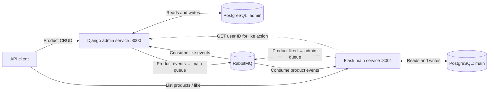

# Product Microservices — Django, Flask & RabbitMQ


A small, event-driven **product management and likes** demonstration built with two Python services. The **Django REST Framework** service manages products, while the **Flask** service provides a product listing and a like action. **RabbitMQ** carries events between them, and each service has its own **PostgreSQL** database.

> **Project status:** This is a learning/prototype codebase, not a production-ready deployment. The current repository has configuration and runtime issues described in [Before you run it](#before-you-run-it). The commands below describe the intended development workflow; a clean start has not been verified.

## Features

- **Product CRUD:** create, list, retrieve, update, and delete products using Django REST Framework.
- **Event-driven synchronization:** Django publishes product-created, -updated, and -deleted messages; a Flask-side consumer updates its local product records.
- **Likes workflow:** the Flask endpoint records a product/user like and publishes an event for Django to increment the product's `likes` counter.
- **Independent data stores:** separate PostgreSQL services for the Django and Flask applications.
- **Container-based development:** a Dockerfile and Compose configuration for each service.

## Architecture



The events are published to RabbitMQ queues named `main` and `admin`. The broker is **external**: neither Compose file defines a RabbitMQ service. The existing application code initializes RabbitMQ connections when the producer/consumer modules load.

## Tech stack

| Component | Libraries / infrastructure |
| --- | --- |
| Admin API | Python, Django **3.1.3**, Django REST Framework **3.12.2** |
| Main API | Python, Flask, Flask-SQLAlchemy, Flask-Migrate, Flask-Script |
| Data storage | PostgreSQL (one database container per Compose project) |
| Messaging | RabbitMQ using `pika` |
| Auxiliary code | Celery tasks in the admin service (worker configuration is commented out in Compose) |
| Local orchestration | Docker and Docker Compose; Dockerfiles use **Python 3.9** |

See [`admin/requirements.txt`](admin/requirements.txt) and [`main/requirements.txt`](main/requirements.txt) for the source-controlled dependency lists. Flask and several other main-service dependencies are unpinned.

## Repository layout

```text
Microservice/
├── admin/
│   ├── admin/                  # Django settings, URL routing, Celery configuration
│   ├── products/               # Models, serializers, API views, events, tasks
│   ├── consumer.py             # Consumes product-liked events
│   ├── manage.py               # Django management commands
│   ├── requirements.txt
│   ├── Dockerfile
│   └── docker-compose.yml
├── main/
│   ├── main.py                 # Flask endpoints and SQLAlchemy models
│   ├── producer.py             # Publishes product-liked events
│   ├── consumer.py             # Consumes product lifecycle events
│   ├── manager.py              # Flask-Migrate / Flask-Script CLI
│   ├── migrations/             # Alembic migration history
│   ├── requirements.txt
│   ├── Dockerfile
│   └── docker-compose.yml
└── .gitignore
```

## Getting started

### Prerequisites

- Git
- Docker Engine / Docker Desktop with the Docker Compose plugin
- A reachable RabbitMQ broker (not provisioned by the included Compose files)
- A local development environment only; **do not deploy the repository's current configuration to a public server**

### Before you run it

The checked-in code requires attention before it can be expected to run reliably:

1. **Rotate exposed credentials.** RabbitMQ connection credentials, a database password, and a Django secret key are committed in source. Remove these values from the code, supply new secrets through environment variables or a secrets manager, and revoke/rotate the exposed credentials. Do not copy the existing values into new configurations.
2. **Fix Docker build and database settings.** Both Dockerfiles have a problematic backslash-continuation line in the `apt-get` step. Database authentication/configuration differs between the two Compose projects. Pin compatible image and package versions as needed.
3. **Configure one accessible RabbitMQ broker** in both producers and consumers. The current hard-coded remote broker URL must be replaced with your own configuration.
4. **Fix application integration issues.** `main/consumer.py` supplies a `likes` field to the Flask `Product` model even though that model does not declare the field. The Flask like endpoint uses a Mac-specific address to reach Django, and the Django user endpoint needs at least one `User` row.
5. **Review development-only settings.** Debug mode, permissive CORS/host settings, and database trust authentication are unsuitable for production.

The steps that follow show how the provided Compose setup is **intended** to be used once these issues are addressed.

### 1. Clone the repository

```bash
git clone https://github.com/Chinmaya1910/Microservice.git
cd Microservice
```

### 2. Start the Django service

In terminal 1:

```bash
cd admin
docker compose up --build
```

The `admin/docker-compose.yml` file defines a `backend`, database migration job, queue consumer, and PostgreSQL database. Its API is mapped to **http://localhost:8000** and its PostgreSQL port to **5455** on the host.

### 3. Start the Flask service

In terminal 2, from the repository root:

```bash
cd main
docker compose up --build
```

The `main/docker-compose.yml` file defines its own `backend`, migration job, queue consumer, and PostgreSQL database. Its API is mapped to **http://localhost:8001** and its PostgreSQL port to **5456** on the host.

> Compose runs the two applications as separate projects. The migration containers do not currently wait for confirmed database readiness. Ensure that each database is ready and migrations have succeeded before testing the endpoints.

### 4. Add a demo user

The Django `GET /api/user/` endpoint selects a random user from the database. After the admin migrations succeed, create at least one user for local testing:

```bash
cd admin
docker compose exec backend python manage.py shell -c \
  "from products.models import User; User.objects.get_or_create(id=1)"
```

Run this command from the repository root (the `cd admin` is only needed if you are not already inside that directory).

## API quick examples

The examples assume both services, their databases, the RabbitMQ broker, and the queue consumers are running after the fixes above.

### Create a product (Django)

```bash
curl -X POST http://localhost:8000/api/products/ \
  -H 'Content-Type: application/json' \
  -d '{"title":"Demo Product","image":"https://example.com/item.png","likes":0}'
```

The Django API saves the product and publishes a `product_created` event for the Flask consumer.

### List products

```bash
# Django's product records
curl http://localhost:8000/api/products/

# Flask's synchronized product records
curl http://localhost:8001/api/products/
```

### Like a product (Flask)

```bash
curl -X POST http://localhost:8001/api/products/1/like/
```

The Flask endpoint asks Django for a user ID, stores a product/user association, and publishes `product_liked` for Django's consumer to update the likes count. Replace `1` with an existing product ID. **As checked in, this workflow has integration and duplicate-like handling limitations; see [Before you run it](#before-you-run-it).**

For route definitions, see [`admin/products/urls.py`](admin/products/urls.py) and [`main/main.py`](main/main.py).

## Development and testing

The repository includes Django's test-module scaffold in [`admin/products/tests.py`](admin/products/tests.py), but it does not yet contain implemented test cases. After a working development environment is configured, Django's test runner can be invoked with:

```bash
cd admin
python manage.py test
```

A passing test suite or automated CI workflow is **not** currently established. When contributing, add tests for the behavior you change, especially for product events, database synchronization, and duplicate likes.

## Contributing

Issues and pull requests are welcome. Open a focused branch, explain the change, include reproduction or verification steps, and avoid committing secrets, local databases, caches, or generated Python files.

- [Report an issue](https://github.com/Chinmaya1910/Microservice/issues)
- [Open a pull request](https://github.com/Chinmaya1910/Microservice/pulls)

No `CONTRIBUTING.md` or `LICENSE` file is present in the reviewed repository. Until a license is added, do not assume permission to reuse the code beyond what applicable law permits.

## Support and maintainer

Maintained by [Chinmaya1910](https://github.com/Chinmaya1910). For questions, bugs, or suggested improvements, use the [issue tracker](https://github.com/Chinmaya1910/Microservice/issues). Include the affected service, reproduction steps, expected behavior, and relevant redacted logs.

---

*Documentation reflects the `main` branch as inspected in November 2026. It describes the implemented structure and intended behavior, not a verified successful deployment.*
